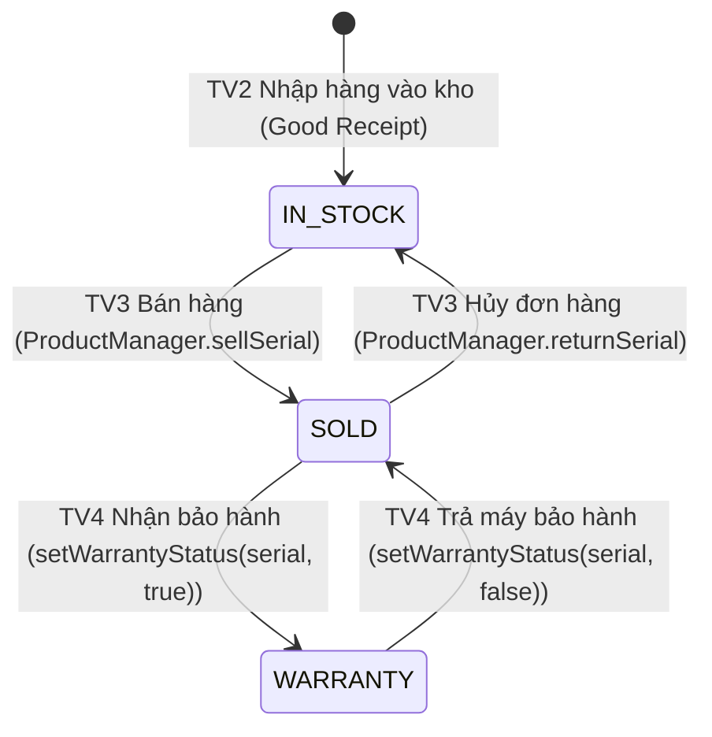

# QUY CHUẨN CODE JAVA & THIẾT KẾ KIẾN TRÚC
# HỆ THỐNG BÁN HÀNG ĐIỆN THOẠI OFFLINE (4 THÀNH VIÊN - 20 CLASS)

---

## 1. Cấu Trúc Gói (Package Structure) Chuẩn Dự Án

Dự án tuân theo cấu trúc phân tầng (Layered Architecture) để mã nguồn của cả 4 thành viên khi tích hợp không bị xung đột:

```text
src/
└── com/
    └── smartphonestore/
        ├── Main.java                          # Điểm vào duy nhất của hệ thống
        │
        ├── model/                             # Chứa 20 Class thực thể & 4 Interface chuẩn
        │   ├── enums/                         # Role.java (ADMIN, WAREHOUSE, SALES), ...
        │   ├── auth/                          # Account.java, ISalaryCalculable.java, Employee.java, ...
        │   ├── product/                       # IDiscountable.java, Product.java, Phone.java, Accessory.java, ProductDetail.java
        │   ├── sale/                          # IPrintable.java, Invoice.java, InvoiceDetail.java, Payment.java, CashPayment.java, ElectronicPayment.java
        │   └── customer/                      # ILoyaltyRankable.java, Customer.java, StandardCustomer.java, VipCustomer.java, CustomerReview.java, WarrantyClaim.java
        │
        ├── manager/                           # Các lớp xử lý nghiệp vụ & lưu trữ
        │   ├── AccountManager.java            # Quản lý tài khoản đăng nhập (TV1)
        │   ├── EmployeeManager.java           # Quản lý nhân viên & tính lương (TV1)
        │   ├── ProductManager.java            # Quản lý kho, serial/IMEI & tồn kho (TV2)
        │   ├── SalesManager.java              # Quản lý hóa đơn & thanh toán (TV3)
        │   └── CustomerManager.java           # Quản lý khách hàng, đánh giá & bảo hành (TV4)
        │
        ├── view/                              # Giao diện Console & Menu theo phân quyền
        │   ├── LoginView.java                 # Màn hình đăng nhập & điều hướng
        │   ├── AdminMenu.java                 # Menu Quản trị viên (TV1)
        │   ├── WarehouseMenu.java             # Menu Kho hàng (TV2)
        │   ├── SalesMenu.java                 # Menu Bán hàng (TV3)
        │   └── CustomerMenu.java              # Menu Khách hàng & Dịch vụ tại quầy (TV4)
        │
        └── util/                              # Thư viện tiện ích dùng chung
            ├── DateUtil.java                  # Chuẩn hóa ngày giờ (dd/MM/yyyy & dd/MM/yyyy HH:mm:ss)
            ├── FileIO.java                    # Đọc/ghi file UTF-8 an toàn
            └── InputHelper.java               # Đọc Scanner an toàn, chống trôi dòng lệnh
```

---

## 2. Quy Chuẩn Định Dạng File Dữ Liệu (`data/`)

Toàn bộ dữ liệu được lưu bằng file text thuần phân tách bởi dấu gạch đứng `|`, mã hóa chuẩn `UTF-8`:

| Tên File | Phụ Trách | Cấu Trúc Header & Thứ Tự Cột Chuẩn |
| :--- | :--- | :--- |
| `accounts.txt` | TV1 | `# Format: id\|username\|password\|role\|status\|lastLoginTime` |
| `employees.txt` | TV1 | `# Format: id\|fullName\|phoneNumber\|baseSalary\|role\|hireYear\|extraValue` |
| `products.txt` | TV2 | `# Format: id\|name\|brand\|price\|stockQuantity\|productType\|minThreshold\|extraValue` |
| `product_details.txt` | TV2 | `# Format: productId\|productName\|serialNumber\|importDate\|importPrice\|supplier\|status` |
| `invoices.txt` | TV3 | `# Format: id\|customerId\|salesStaffId\|creationDate\|totalAmount\|status(PAID/CANCELLED)\|vatTaxRate` |
| `invoice_details.txt` | TV3 | `# Format: invoiceId\|productId\|productName\|serialNumber\|unitPrice\|quantity` |
| `payments.txt` | TV3 | `# Format: id\|invoiceId\|amount\|paymentDate\|method\|transactionCode\|extraData` |
| `reviews.txt` | TV4 | `# Format: reviewId\|customerId\|productId\|ratingStars\|comment\|reviewDate` |
| `warranty_claims.txt` | TV4 | `# Format: id\|mã khách\|mã sản phẩm\|seri\|lỗi\|ngày giờ nhận|trạng thái\|ngày bán\|số tháng BH` |

### Quy ước định dạng ngày giờ:
- **Chỉ sử dụng `DateUtil`** do nhóm xây dựng để đảm bảo tính đồng bộ:
  - Định dạng ngày: `dd/MM/yyyy` (Ví dụ: `12/11/2026`).
  - Định dạng ngày kèm giờ: `dd/MM/yyyy HH:mm:ss` (Ví dụ: `12/11/2026 09:30:00`).
- Phương thức `DateUtil.parse(text)` tự động cắt lấy 10 ký tự đầu (`s.substring(0, 10)`), cho phép đọc an toàn cả chuỗi chỉ có ngày và chuỗi có kèm giờ phút giây.

---

## 3. Quy Chuẩn Vòng Đời Serial & Đồng Bộ Dữ Liệu Giữa Các Thành Viên

Để loại bỏ hoàn toàn tình trạng sai lệch tồn kho, giá nhập và trạng thái máy, các thành viên tuân theo hợp đồng giao tiếp sau:



1. **TV2 cung cấp đầy đủ các phương thức Serial cho toàn nhóm:**
   - `sellSerial(serial)`: Chuyển serial thành `SOLD`, giảm `stockQuantity` trong `products.txt` đi 1, lưu cả 2 file.
   - `returnSerial(serial)`: Chuyển serial từ `SOLD` về `IN_STOCK`, tăng `stockQuantity` lên 1, lưu cả 2 file.
   - `setWarrantyStatus(serial, inWarranty)`: Chuyển đổi trạng thái giữa `SOLD` $\leftrightarrow$ `WARRANTY` (không đổi tồn kho vì máy là của khách).
   - `checkSellable(serial)`: Trả về `null` nếu máy hợp lệ để bán, hoặc thông báo lỗi nếu máy không ở trạng thái `IN_STOCK`.
   - `syncStockFromDetails()`: Tự động đếm số lượng serial `IN_STOCK` thực tế để gán cho `stockQuantity` của sản phẩm tương ứng.
2. **Quy chuẩn Chiết khấu & Cập nhật giá (`applyDiscount`):**
   - Khi áp dụng chiết khấu hoặc cập nhật giá bán, hệ thống **chỉ cập nhật giá bán niêm yết `price` trong `products.txt`**.
   - **Tuyệt đối không được ghi đè `importPrice` (giá vốn nhập hàng)** trong `product_details.txt`.
3. **Quy chuẩn Bảo hành đa hình (`Product.getWarrantyMonths()`):**
   - Khai báo phương thức trừu tượng `public abstract int getWarrantyMonths();` trong lớp cha `Product`.
   - Lớp con `Phone` ghi đè: iOS trả về `12`, Android trả về `18`.
   - Lớp con `Accessory` ghi đè: Phụ kiện trả về cố định `6` tháng bảo hành.
   - Bất kỳ thành viên nào (đặc biệt là TV4) có đối tượng `Product p` đều có thể lấy số tháng bảo hành trực tiếp mà không cần ép kiểu.

---

## 4. Quy Ước Đặt Tên & Lập Trình OOP Chuẩn

1. **Đặt tên chuẩn Java:**
   - **Tên Class & Interface:** Viết theo kiểu `PascalCase` (Ví dụ: `Product`, `Smartphone`, `ISalaryCalculable`).
   - **Tên Biến & Phương thức:** Viết theo kiểu `camelCase` (Ví dụ: `stockQuantity`, `calculateSalary()`, `checkLogin()`).
   - **Hằng số & Enum:** Viết theo kiểu `UPPER_SNAKE_CASE` (Ví dụ: `IN_STOCK`, `SOLD`, `WARRANTY`, `TIEP_NHAN`, `DANG_SUA`).
2. **Đóng gói thuộc tính (Encapsulation):**
   - Toàn bộ thuộc tính phải để `private` hoặc `protected`.
   - Cung cấp đầy đủ các phương thức `getter` và `setter` có kèm kiểm tra hợp lệ ném ngoại lệ `ValidationException`.
3. **Kế thừa & Đa hình (Inheritance & Polymorphism):**
   - Khi ghi đè phương thức từ lớp cha hoặc interface, bắt buộc sử dụng annotation `@Override`.
   - Constructor lớp con phải gọi `super(...)` truyền dữ liệu khởi tạo cho lớp cha trước khi gán thuộc tính riêng.

---

## 5. Quy Chuẩn Nhập Liệu Console (Chống Trôi Lệnh)

1. **Tuyệt đối không gọi `scanner.nextInt()` hay `scanner.nextDouble()` rồi sau đó gọi `scanner.nextLine()`:**
   - Phím Enter để lại ký tự `\n` trong bộ đệm khiến lần nhập chuỗi tiếp theo bị trôi qua mất dữ liệu.
2. **Luôn sử dụng `scanner.nextLine().trim()`:**
   - Chuyển đổi kiểu dữ liệu thông qua `Integer.parseInt()` hoặc `Double.parseDouble()` trong khối `try-catch` kiểm tra lỗi số.

---

## 6. Tiêu Chuẩn Phương Thức Riêng & Thuộc Tính Riêng (Ba-rem Chấm Điểm)

1. **Mỗi Class bắt buộc có ít nhất 1 phương thức riêng biệt** phục vụ nghiệp vụ của nó:
   - Phương thức riêng phải có công thức tính toán hoặc logic điều kiện rõ ràng (ví dụ: `calculateSalary()`, `isLowStock()`, `calculateChange()`, `isCompatibleWith()`, `isEligibleForUpgrade()`).
2. **Khi in thông tin (`displayInfo()` hoặc `displayRow()`):**
   - Sử dụng `System.out.printf` định dạng cột thẳng hàng, căn lề đẹp mắt, hiển thị đầy đủ thông tin nhận diện sản phẩm, ngày tháng và trạng thái.
