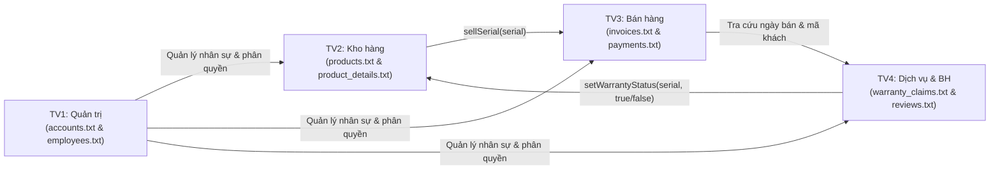

# TÓM TẮT DỰ ÁN (PROJECT SUMMARY)
# HỆ THỐNG BÁN HÀNG ĐIỆN THOẠI OFFLINE (SMARTPHONE STORE)
> **Ngôn ngữ:** Java (OOP Console Application)  
> **Quy mô nhóm:** Đúng 4 thành viên  
> **Quy mô kiến trúc:** Đúng 20 Class thực thể + 4 Interface chuẩn (Mỗi người đúng 5 Class + 1 Interface)  
> **Mô hình phân công Menu độc lập:** **4 THÀNH VIÊN = 4 BẢNG MENU RIÊNG BIỆT (Mỗi bạn làm trọn vẹn 1 Menu)**  
> **Luồng vận hành:** Đăng nhập tập trung ➔ Nhận diện Role (ADMIN / WAREHOUSE / SALES) ➔ Chuyển ngay vào Menu tương ứng của từng thành viên.

---

## 1. Mục Tiêu & Kiến Trúc "1 Thành Viên = 1 Menu Độc Lập"

Để phân chia công việc rạch ròi 100%, không bị chồng chéo code và khi thi vấn đáp mỗi thành viên chỉ cần demo trọn vẹn đúng Menu của mình:
- **Khởi động ứng dụng (Entry Point):** Mới vào hiển thị **Màn hình Đăng nhập (Login)**. Hệ thống tra cứu tài khoản trong `data/accounts.txt`, xác định `Role` trong 3 vai trò nội bộ của cửa hàng:
  - `Role = ADMIN` ➔ Mở **Menu ADMIN** (Do **Thành viên 1** code 100% - kiêm quyền điều hướng sang CustomerMenu và phân quyền xóa khách).
  - `Role = WAREHOUSE` ➔ Mở **Menu KHO HÀNG** (Do **Thành viên 2** code 100% - quản lý tồn kho và vòng đời Serial cho cả nhóm).
  - `Role = SALES` ➔ Mở **Menu BÁN HÀNG** (Do **Thành viên 3** code 100% - gọi `sellSerial` của TV2, kiêm điều hướng sang CustomerMenu tại quầy).
  *(Thành viên 4 chịu trách nhiệm 100% cho **MENU KHÁCH HÀNG & DỊCH VỤ (CustomerMenu)**, được Admin và Bán hàng gọi ra trực tiếp tại quầy POS).*
- **Liên kết giữa các thành viên:** Menu của mỗi bạn chỉ tập trung gọi các class do chính bạn đó viết. Nếu cần liên kết (ví dụ: Bán hàng cần trừ tồn kho), chỉ gọi đúng **1 hàm kết quả duy nhất** từ Manager của bạn khác (ví dụ `productManager.sellSerial(serial)`).

---

## 2. Bảng Phân Bổ Chuẩn: 4 Thành Viên = 20 Class = 4 Interface = 4 Menu

| Thành viên | Phân hệ nghiệp vụ | 1 Interface chuẩn | 5 Class thực thể đảm nhiệm (Mỗi class có CRUD + 1 thuộc tính riêng + 1 hàm riêng) | 1 Menu chuyên trách (100% tự làm) |
| :--- | :--- | :--- | :--- | :--- |
| **👤 THÀNH VIÊN 1** | **Quản trị Hệ thống & Nhân sự** | `ISalaryCalculable` | 1. `Account`<br>2. `Employee`<br>3. `AdminStaff`<br>4. `WarehouseStaff`<br>5. `SalesStaff` | **MENU ADMIN**<br>*(Kèm Màn hình Login/Register)* |
| **👤 THÀNH VIÊN 2** | **Quản lý Kho & Danh mục Sản phẩm** | `IDiscountable` | 6. `Product`<br>7. `Phone`<br>8. `Smartphone`<br>9. `FeaturePhone`<br>10. `Accessory`<br>*(+ `ProductDetail` quản lý Serial)* | **MENU KHO HÀNG** |
| **👤 THÀNH VIÊN 3** | **Quản lý Bán hàng & Hóa đơn** | `IPrintable` | 11. `Invoice`<br>12. `InvoiceDetail`<br>13. `Payment`<br>14. `CashPayment`<br>15. `ElectronicPayment` | **MENU BÁN HÀNG** |
| **👤 THÀNH VIÊN 4** | **Quản lý Khách hàng & Dịch vụ Hậu mãi** | `ILoyaltyRankable` | 16. `Customer`<br>17. `StandardCustomer`<br>18. `VipCustomer`<br>19. `CustomerReview`<br>20. `WarrantyClaim` | **MENU KHÁCH HÀNG & DỊCH VỤ**<br>*(CustomerMenu)* |

---

## 3. Sơ Đồ Cây Kiến Trúc Tổng Thể

```text
========================================================================================================================
                          HỆ THỐNG BÁN HÀNG ĐIỆN THOẠI OFFLINE (20 CLASS + 4 INTERFACE)
========================================================================================================================
│
├── 👤 [THÀNH VIÊN 1] MENU ADMIN (QUẢN TRỊ VIÊN & NHÂN SỰ)
│   ├── <<Interface>> ISalaryCalculable ────────────────────────────► Hàm: calculateSalary()
│   ├── Account [File: accounts.txt] ────────────────────────────────► Thuộc tính riêng: lastLoginTime
│   └── (Lớp Cha) Employee [File: employees.txt] ───────────────────► Thuộc tính riêng: hireYear
│       ├── AdminStaff (kế thừa Employee) ──────────────────────────► Thuộc tính riêng: managementBonus
│       ├── WarehouseStaff (kế thừa Employee) ──────────────────────► Thuộc tính riêng: warehouseZone
│       └── SalesStaff (kế thừa Employee) ──────────────────────────► Thuộc tính riêng: commissionRate
│
├── 👤 [THÀNH VIÊN 2] MENU KHO HÀNG (QUẢN LÝ SẢN PHẨM & TỒN KHO)
│   ├── <<Interface>> IDiscountable ────────────────────────────────► Hàm: calculateDiscountedPrice()
│   ├── (Lớp Cha) Product [File: products.txt] ─────────────────────► Thuộc tính riêng: minStockThreshold & getWarrantyMonths()
│   │   ├── (Lớp Con) Phone (kế thừa Product) ──────────────────────► Thuộc tính riêng: operatingSystem & getWarrantyMonths()
│   │   │   ├── Smartphone (kế thừa Phone) ─────────────────────────► Thuộc tính riêng: storageCapacity & applyTradeInDiscount()
│   │   │   └── FeaturePhone (kế thừa Phone) ───────────────────────► Thuộc tính riêng: batteryLifeDays & toggleSosMode()
│   │   └── (Lớp Con) Accessory (kế thừa Product) ──────────────────► Thuộc tính riêng: accessoryType & getWarrantyMonths()=6
│   └── (Class Bổ Trợ) ProductDetail [File: product_details.txt] ───► Quản lý Serial/IMEI, Ngày giờ nhập, Trạng thái (IN_STOCK/SOLD/WARRANTY)
│
├── 👤 [THÀNH VIÊN 3] MENU BÁN HÀNG (HÓA ĐƠN & GIAO DỊCH THANH TOÁN)
│   ├── <<Interface>> IPrintable ───────────────────────────────────► Hàm: printReceipt()
│   ├── Invoice [File: invoices.txt] ───────────────────────────────► Thuộc tính riêng: vatTaxRate & calculateFinalTotal()
│   ├── InvoiceDetail [File: invoice_details.txt] ──────────────────► Thuộc tính riêng: serialNumber & quantity=1
│   └── (Lớp Cha) Payment [File: payments.txt] ─────────────────────► Thuộc tính riêng: transactionCode & verifyPaymentStatus()
│       ├── CashPayment (kế thừa Payment) ──────────────────────────► Thuộc tính riêng: cashGiven & calculateChange()
│       └── ElectronicPayment (kế thừa Payment) ────────────────────► Thuộc tính riêng: bankOrWalletName & generatePaymentQRCode()
│
└── 👤 [THÀNH VIÊN 4] MENU KHÁCH HÀNG & DỊCH VỤ (CUSTOMER & SERVICE MANAGEMENT)
    ├── <<Interface>> ILoyaltyRankable ─────────────────────────────► Hàm: evaluateRank()
    ├── (Lớp Cha) Customer [File: customers.txt] ───────────────────► Thuộc tính riêng: totalSpent & accumulateSpending()
    │   ├── StandardCustomer (kế thừa Customer) ────────────────────► Thuộc tính riêng: visitCount & upgradeToVip()
    │   └── VipCustomer (kế thừa Customer) ─────────────────────────► Thuộc tính riêng: vipDiscountRate & calculateVipDiscount()
    ├── CustomerReview [File: reviews.txt] ─────────────────────────► Thuộc tính riêng: ratingStars & isPositiveFeedback()
    └── WarrantyClaim [File: warranty_claims.txt] ──────────────────► Cấu trúc 9 cột: id|mã khách|mã sản phẩm|seri|lỗi|ngày giờ nhận|trạng thái|ngày bán|số tháng BH
========================================================================================================================
```

---

## 4. Quản Lý Dữ Liệu Đồng Bộ Giữa 4 Phân Hệ



1. **Vòng đời Serial/IMEI**: Mỗi máy bán ra đều có đúng 1 số Serial duy nhất được quản lý xuyên suốt từ lúc nhập kho (`IN_STOCK`), bán ra (`SOLD`), cho đến tiếp nhận bảo hành (`WARRANTY`) và trả máy lại cho khách (`SOLD`).
2. **Bảo tồn giá vốn nhập hàng**: Giá bán niêm yết trong `products.txt` có thể thay đổi hoặc áp dụng chiết khấu `applyDiscount`, nhưng giá nhập `importPrice` trong `product_details.txt` được bảo toàn nguyên vẹn.
3. **Cấu trúc lưu phiếu bảo hành mới**: `warranty_claims.txt` lưu đúng chuẩn 9 cột: `id|mã khách|mã sản phẩm|seri|lỗi|ngày giờ nhận|trạng thái|ngày bán|số tháng BH`, liên kết chặt chẽ với số tháng bảo hành của sản phẩm (`getWarrantyMonths()`) và hóa đơn của khách.
